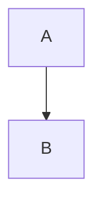

Events can repeat. Read the [webhooks guide](./webhooks) to react to changes, or go back to the [home page](/).

```ts title="recur.ts" {2-3} lines
const rule = {
  every: 'week',
  on: ['mon', 'wed'],
};
```

<Check>Time zones are handled for you.</Check>

| Field | Meaning |
|---|---|
| `every` | the unit |
| `on` | the days |

Inline math $E = mc^2$ and a block:

$$
\sum_{i=1}^{n} i = \frac{n(n+1)}{2}
$$



<Update label="v2.0" description="November" tags={["Feature", "Breaking"]}>
  Orbit 2.0 ships a faster scheduler.
</Update>
