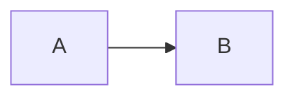

# Syntax tour

## Tabs

=== "pip"

    ```bash
    pip install acme
    ```

=== ":fontawesome-brands-python: uv"

    ```bash
    uv add acme
    ```

/// note | Blocks syntax
Content of a `///` block.
///

/// details | Click to expand
    open: true
Hidden text.
///

Definitions
:   A term and its definition.

This is ==highlighted== text with :material-check: an icon.

$$
\cos x=\sum_{k=0}^{\infty}\frac{(-1)^k}{(2k)!}x^{2k}
$$

Inline math \(a^2 + b^2\) works too.



<div class="grid cards" markdown>

-   __Fast__

    Builds in seconds.

</div>

``` { .yaml .annotate }
key: value # (1)
```

1. An annotation.
